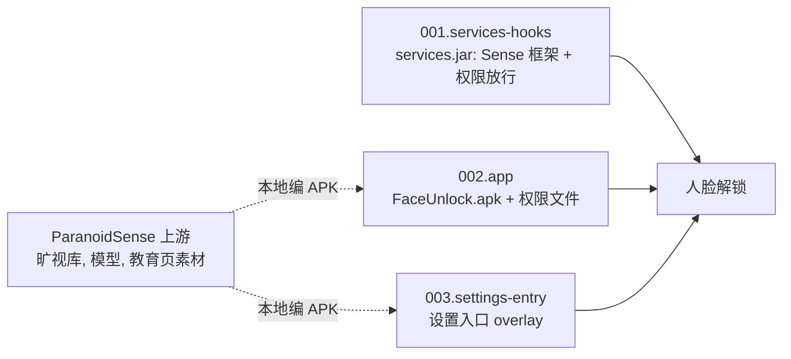

# tb321fu-faceunlock-patch — 设计

## 多语言

**简体中文** | [English](en/DESIGN.md) | [Español](es/DESIGN.md)

## 文档

- 项目概览: [README](../README.md)

- 设计思路: [DESIGN](DESIGN.md)

- 项目状态: [LOG](LOG.md)
- 历史记录: [HISTORY](HISTORY.md)
- 变更日志: [CHANGELOG](CHANGELOG.md)

- 第三方声明: [THIRD_PARTY_NOTICES](THIRD_PARTY_NOTICES.md)

## 设计目标

- [x] TB321FU 刷 GSI 后免 root 使用人脸解锁, 能录入和解锁.
- [x] 不需要 platform 签名, 不重新编 ROM; 所有改动都在 system 镜像内.
- [x] 只对装在 `/system/priv-app` 的 `com.android.faceunlock` 放宽生物识别权限, 其他调用方的检查不变.
- [x] 底包不匹配时构建停止, 不产出缺功能的镜像.
- [x] 仓库不含旷视的二进制, 设置教育页素材和签名密钥.
- [ ] 在 bp1a 和 cp3a 底包上真机验证.
- 非目标: 支持 TB321FU 以外的设备, 或脱离 TB321FU-GSI-Mods 单独构建. 其他设备和 KernelSU / Magisk 模块方式见 [paranoidsense-gsi-port](https://github.com/CharlesGool/paranoidsense-gsi-port).

## 架构

本项目是 [TB321FU-GSI-Mods](https://github.com/CharlesGool/TB321FU-GSI-Mods) 的补丁. 每个底包一个目录, Mods 只在底包 ID 匹配时执行该目录的 `apply.sh`; `apply.sh` 用 Mods 的 `run_parts` 按编号执行 3 个部分的 `part.sh`.

3 个部分之间没有构建依赖, 功能上缺一不可. `001.services-hooks` 在构建时从当前底包的 `services.jar` 现场生成新 jar; 两个 APK 在构建前本地编好, 放在各自的 `files/`, 不进仓库. 各部分的原理见各底包目录的 README.

| 顶层目录 | 职责 |
| --- | --- |
| `patch/<底包 ID>/` | 一个底包的补丁, 同步到 Mods 的 `patches/required/tangorpro/<底包 ID>/faceunlock/`. `patch.conf` 是元数据, `apply.sh` 是入口, `parts/NNN.<部分>/` 下是各部分的脚本, 源码, 权限文件和说明 |
| `doc/` | 项目文档. 通用移植教程在 [paranoidsense-gsi-port](https://github.com/CharlesGool/paranoidsense-gsi-port) |

3 个底包目录的差异只在 `parts/001.services-hooks/` (Sense 框架类的构造器签名, `apply_hooks.py` 的注入点, ART apex 格式), 其他文件相同.

本项目没有界面文本, 也没有构建输出; 镜像构建输出在 Mods 的 `out/`.

## 设计约束

- 旷视的 so, jar 和模型, 设置教育页素材, `FaceUnlock.apk`, `FaceUnlockSettingsOverlay.apk` 和签名密钥**禁止**进仓库. `.gitignore` 忽略这些文件.
- `services.jar` **必须**从要刷的底包现场生成, **禁止**在底包之间复用.
- 权限放行**禁止**扩大到 `/system/priv-app` 下的 `com.android.faceunlock` 以外的调用方.
- d8 **禁止**加 `--no-desugaring`; `check_dex.py` 报告问题时构建**必须**停止.
- `apply_hooks.py` 打完后 smali 中仍有 `USE_BIOMETRIC_INTERNAL` 调用点或 Sense 入口未命中时, 构建**必须**停止.
- 新底包**必须**新建自己的目录, **禁止**修改已有底包目录去适配新底包.
- `patch/` 的修改**必须**先在本仓库提交, 再同步到 Mods.

## 数据设计

设备上的运行数据, 不在仓库中:

| 位置 | 内容 |
| --- | --- |
| `com.android.faceunlock` 的应用数据 | 人脸模板和录入状态. 清除应用数据会删除人脸 |
| `ro.face.sense_service=true` | system_server 据此注册 `SenseProvider` |
| `ro.face.sense_service.camera_id` | 可选, 指定识别用的相机 |

## 外部接口

| 接口 | 提供方 | 用途 |
| --- | --- | --- |
| 补丁格式 (`patch.conf`, `apply.sh`, `run_parts`), 构建函数, `toolkit/jarpatch.py` | TB321FU-GSI-Mods | 改写 system 镜像, 回编 `services.jar` |
| 构建参数 | Mods 的 `devices/<设备>/conf.d/faceunlock.conf` | 定位编译工具 |
| `stale-boot-image` 补丁 | TB321FU-GSI-Mods | 删除过期的 `services` oat 产物 |
| 旷视库, 模型和教育页素材 | [PixelOS ParanoidSense](https://github.com/PixelOS-AOSP/packages_apps_ParanoidSense) 固定 commit | 编两个 APK |
| `vendor.aospa.biometrics.face.ISenseService` | 本项目 (AIDL) | system_server 和应用之间的识别接口 |
