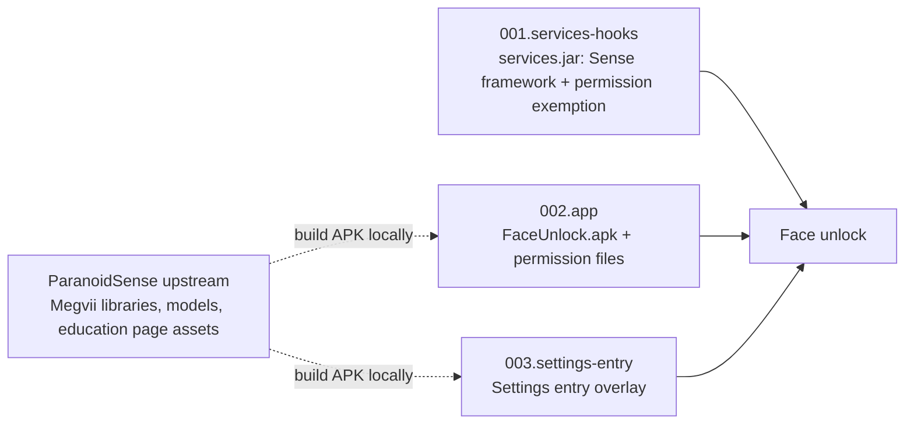

# tb321fu-faceunlock-patch — Design

## Multi-language

[简体中文](../DESIGN.md) | **English** | [Español](../es/DESIGN.md)

## Documentation

- Project overview: [README](README.md)

- Design rationale: [DESIGN](DESIGN.md)

- Project status: [LOG](LOG.md)
- Historical records: [HISTORY](HISTORY.md)
- Version changelog: [CHANGELOG](CHANGELOG.md)

- Third-party notices: [THIRD_PARTY_NOTICES](THIRD_PARTY_NOTICES.md)

## Design Goals

- [x] Use face unlock on a TB321FU with a GSI without root, with enrollment and unlocking working.
- [x] No platform signature needed and no ROM rebuild; all changes are inside the system image.
- [x] Relax biometric permissions only for `com.android.faceunlock` installed in `/system/priv-app`; checks for other callers are unchanged.
- [x] Stop the build when the base image does not match, so no image with missing features is produced.
- [x] The repository contains no Megvii binaries, settings education page assets or signing keys.
- [ ] Verify on real devices with the bp1a and cp3a base images.
- Non-goals: supporting devices other than TB321FU, or building without TB321FU-GSI-Mods. Other devices and the KernelSU / Magisk module approach are described by [paranoidsense-gsi-port](https://github.com/CharlesGool/paranoidsense-gsi-port).

## Architecture

This project is a patch for [TB321FU-GSI-Mods](https://github.com/CharlesGool/TB321FU-GSI-Mods). Each base image has its own directory, and Mods runs that directory's `apply.sh` only when the base image ID matches; `apply.sh` uses the Mods `run_parts` to run the `part.sh` of the 3 parts in numbered order.

The 3 parts have no build dependencies on each other, but functionally none can be omitted. `001.services-hooks` generates a new jar on the fly from the `services.jar` of the current base image at build time; the two APKs are built locally before the build, placed in their respective `files/`, and kept out of the repository. For the principles of each part, see the README in each base image directory.

| Top-level directory | Responsibility |
| --- | --- |
| `patch/<base image ID>/` | The patch for one base image, synchronized to `patches/required/tangorpro/<base image ID>/faceunlock/` in Mods. `patch.conf` is the metadata, `apply.sh` is the entry point, and `parts/NNN.<part>/` holds each part's scripts, source, permission files and description |
| `doc/` | Project documentation. The general porting tutorial is in [paranoidsense-gsi-port](https://github.com/CharlesGool/paranoidsense-gsi-port) |

The 3 base image directories differ only in `parts/001.services-hooks/` (constructor signatures of the Sense framework classes, the injection points of `apply_hooks.py`, the ART apex format); all other files are identical.

This project has no UI text and no build output; image build output goes to `out/` in Mods.

## Design Constraints

- Megvii's so, jar and models, the settings education page assets, `FaceUnlock.apk`, `FaceUnlockSettingsOverlay.apk` and the signing keys **MUST NOT** enter the repository. `.gitignore` ignores these files.
- `services.jar` **MUST** be generated on the fly from the base image to be flashed, and **MUST NOT** be reused across base images.
- The permission exemption **MUST NOT** be extended to any caller other than `com.android.faceunlock` under `/system/priv-app`.
- d8 **MUST NOT** use `--no-desugaring`; the build **MUST** stop when `check_dex.py` reports problems.
- After `apply_hooks.py` finishes, the build **MUST** stop if smali still contains `USE_BIOMETRIC_INTERNAL` call sites or a Sense entry point was not matched.
- A new base image **MUST** get its own new directory; existing base image directories **MUST NOT** be modified to fit a new base image.
- Changes to `patch/` **MUST** be committed in this repository first, then synchronized to Mods.

## Data Design

Runtime data on the device, not in the repository:

| Location | Content |
| --- | --- |
| App data of `com.android.faceunlock` | Face templates and enrollment state. Clearing the app data deletes the faces |
| `ro.face.sense_service=true` | system_server registers `SenseProvider` based on this |
| `ro.face.sense_service.camera_id` | Optional, specifies the camera used for recognition |

## External Interfaces

| Interface | Provider | Purpose |
| --- | --- | --- |
| Patch format (`patch.conf`, `apply.sh`, `run_parts`), build functions, `toolkit/jarpatch.py` | TB321FU-GSI-Mods | Rewrite the system image, rebuild `services.jar` |
| Build parameters | `devices/<device>/conf.d/faceunlock.conf` in Mods | Locate the build tools |
| `stale-boot-image` patch | TB321FU-GSI-Mods | Delete stale `services` oat artifacts |
| Megvii libraries, models and education page assets | [PixelOS ParanoidSense](https://github.com/PixelOS-AOSP/packages_apps_ParanoidSense) at a pinned commit | Build the two APKs |
| `vendor.aospa.biometrics.face.ISenseService` | This project (AIDL) | Recognition interface between system_server and the app |
