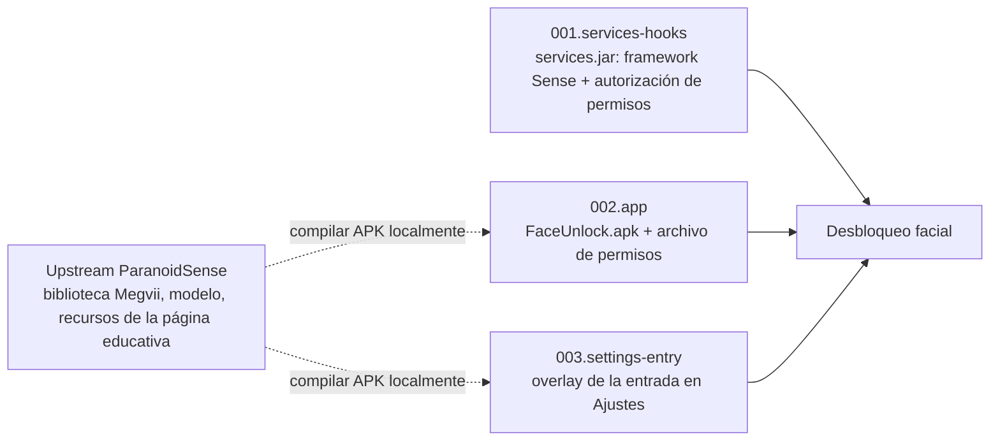

# tb321fu-faceunlock-patch — Diseño

## Multilingüe

[简体中文](../DESIGN.md) | [English](../en/DESIGN.md) | **Español**

## Documentación

- Descripción general del proyecto: [README](README.md)

- Justificación del diseño: [DESIGN](DESIGN.md)

- Estado del proyecto: [LOG](LOG.md)
- Registros históricos: [HISTORY](HISTORY.md)
- Historial de cambios: [CHANGELOG](CHANGELOG.md)

- Avisos de terceros: [THIRD_PARTY_NOTICES](THIRD_PARTY_NOTICES.md)

## Objetivos de diseño

- [x] Usar el desbloqueo facial sin root en la TB321FU con GSI, con registro y desbloqueo funcionando.
- [x] No requiere firma de plataforma ni recompilar la ROM; todos los cambios quedan dentro de la imagen system.
- [x] Solo se relajan los permisos de biometría para `com.android.faceunlock` instalada en `/system/priv-app`; las comprobaciones para otros llamantes no cambian.
- [x] Si la imagen base no coincide, la construcción se detiene y no produce una imagen sin la función.
- [x] El repositorio no contiene binarios de Megvii, recursos de la página educativa de Ajustes ni claves de firma.
- [ ] Verificar en dispositivo real con las imágenes base bp1a y cp3a.
- No objetivo: dar soporte a dispositivos distintos de la TB321FU, o construir sin TB321FU-GSI-Mods. Otros dispositivos y el método con módulos KernelSU / Magisk están en [paranoidsense-gsi-port](https://github.com/CharlesGool/paranoidsense-gsi-port).

## Arquitectura

Este proyecto es un parche de [TB321FU-GSI-Mods](https://github.com/CharlesGool/TB321FU-GSI-Mods). Hay un directorio por imagen base; Mods solo ejecuta el `apply.sh` de ese directorio cuando el ID de la imagen base coincide; `apply.sh` usa `run_parts` de Mods para ejecutar por número el `part.sh` de las 3 partes.

Las 3 partes no tienen dependencias de construcción entre sí, pero funcionalmente ninguna puede faltar. `001.services-hooks` genera en el momento de la construcción un jar nuevo a partir del `services.jar` de la imagen base actual; los dos APK se compilan localmente antes de la construcción y se colocan en sus respectivos `files/`, sin entrar en el repositorio. El principio de cada parte está en el README de cada directorio de imagen base.

| Directorio de nivel superior | Responsabilidad |
| --- | --- |
| `patch/<ID de imagen base>/` | El parche de una imagen base, sincronizado con `patches/required/tangorpro/<ID de imagen base>/faceunlock/` de Mods. `patch.conf` son los metadatos, `apply.sh` es el punto de entrada, y en `parts/NNN.<parte>/` están los scripts, el código fuente, los archivos de permisos y las descripciones de cada parte |
| `doc/` | Documentación del proyecto. El tutorial general de portado está en [paranoidsense-gsi-port](https://github.com/CharlesGool/paranoidsense-gsi-port) |

Los 3 directorios de imagen base difieren solo en `parts/001.services-hooks/` (firmas de constructores de las clases del framework Sense, puntos de inyección de `apply_hooks.py`, formato del apex de ART); el resto de archivos es idéntico.

Este proyecto no tiene textos de interfaz ni salida de construcción; la salida de construcción de la imagen está en `out/` de Mods.

## Restricciones de diseño

- Los so, jar y modelos de Megvii, los recursos de la página educativa de Ajustes, `FaceUnlock.apk`, `FaceUnlockSettingsOverlay.apk` y las claves de firma **MUST NOT** entrar en el repositorio. `.gitignore` ignora estos archivos.
- `services.jar` **MUST** generarse en el momento a partir de la imagen base que se va a flashear, y **MUST NOT** reutilizarse entre imágenes base.
- La autorización de permisos **MUST NOT** ampliarse a llamantes distintos de `com.android.faceunlock` bajo `/system/priv-app`.
- d8 **MUST NOT** llevar `--no-desugaring`; cuando `check_dex.py` informe de problemas, la construcción **MUST** detenerse.
- Si tras aplicar `apply_hooks.py` el smali aún contiene puntos de llamada a `USE_BIOMETRIC_INTERNAL` o no se localiza una entrada de Sense, la construcción **MUST** detenerse.
- Una imagen base nueva **MUST** tener su propio directorio nuevo, y **MUST NOT** modificarse un directorio de imagen base existente para adaptarlo a la nueva.
- Los cambios en `patch/` **MUST** confirmarse primero en este repositorio y luego sincronizarse con Mods.

## Diseño de datos

Datos de ejecución en el dispositivo, que no están en el repositorio:

| Ubicación | Contenido |
| --- | --- |
| Datos de la app `com.android.faceunlock` | Plantillas faciales y estado del registro. Borrar los datos de la app elimina los rostros |
| `ro.face.sense_service=true` | Según esta propiedad, system_server registra `SenseProvider` |
| `ro.face.sense_service.camera_id` | Opcional, indica la cámara usada para el reconocimiento |

## Interfaces externas

| Interfaz | Proveedor | Finalidad |
| --- | --- | --- |
| Formato de parche (`patch.conf`, `apply.sh`, `run_parts`), funciones de construcción, `toolkit/jarpatch.py` | TB321FU-GSI-Mods | Reescribir la imagen system y recompilar `services.jar` |
| Parámetros de construcción | `devices/<dispositivo>/conf.d/faceunlock.conf` de Mods | Localizar las herramientas de compilación |
| Parche `stale-boot-image` | TB321FU-GSI-Mods | Eliminar los artefactos oat obsoletos de `services` |
| Biblioteca y modelo de Megvii y recursos de la página educativa | Commit fijo de [PixelOS ParanoidSense](https://github.com/PixelOS-AOSP/packages_apps_ParanoidSense) | Compilar los dos APK |
| `vendor.aospa.biometrics.face.ISenseService` | Este proyecto (AIDL) | Interfaz de reconocimiento entre system_server y la app |
